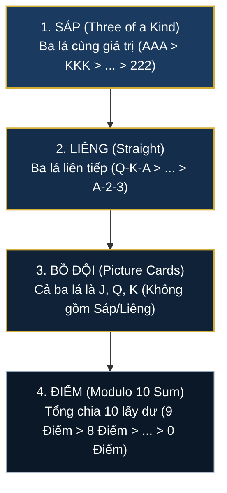
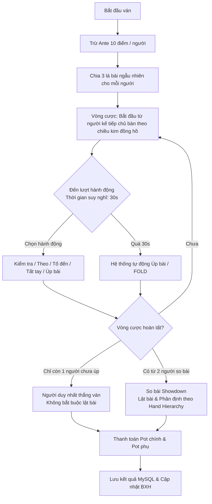

# Luật Chơi Ba Cây (Game Rules)

Tài liệu này quy định đầy đủ và chính xác toàn bộ luật chơi, phân cấp xếp bài, cơ chế so chất và quy tắc đặt cược trong trò chơi **Ba Cây Online**.

---

## 1. Quy Định Chung & Bộ Bài

- **Bộ bài sử dụng:** Bộ bài Tây tiêu chuẩn **52 lá** (từ 2 đến Át, gồm 4 chất: Bích ♠, Chuồn/Tép ♣, Rô ♦, Cơ ♥).
- **Số lượng người chơi:** Mỗi bàn có từ **2 đến 8 người chơi**.
- **Tiền cược sàn (Ante):** Mỗi người chơi khi bắt đầu ván bài phải góp mức cược cơ bản của bàn (mặc định là **10 điểm**, chủ bàn có quyền tùy chỉnh).
- **Chia bài:** Mỗi người chơi được chia ngẫu nhiên **3 lá bài** kín từ bộ bài 52 lá đã được xáo trộn ngẫu nhiên. Trong suốt ván, không bao giờ xảy ra tình trạng trùng lá giữa các người chơi.

---

## 2. Thứ Tự Phân Loại Bộ Bài (Hand Hierarchy)

Thứ tự sức mạnh của các bộ bài được xếp từ cao xuống thấp như sau:

$$\mathbf{Sáp} > \mathbf{Liêng} > \mathbf{Bồ\ Đội} > \mathbf{Điểm}$$

### 2.1. Sáp (Three of a Kind)
- **Định nghĩa:** Bộ 3 lá bài có **cùng giá trị số**.
- **Thứ tự giá trị:**
  $$\mathbf{A-A-A} > \mathbf{K-K-K} > \mathbf{Q-Q-Q} > \mathbf{J-J-J} > \mathbf{10-10-10} > \dots > \mathbf{2-2-2}$$
- Sáp Át (A-A-A) là bộ bài mạnh nhất trong trò chơi.

### 2.2. Liêng (Straight)
- **Định nghĩa:** Bộ 3 lá bài có **giá trị số liên tiếp nhau** (không bắt buộc đồng chất).
- **Thứ tự giá trị:**
  - Cao nhất: **Q - K - A** (Liêng đại).
  - Tiếp theo: **J - Q - K** > **10 - J - Q** > **9 - 10 - J** > ... > **2 - 3 - 4**.
  - Thấp nhất: **A - 2 - 3** (Át được tính là 1 trong chuỗi thấp nhất).
- **So sánh khi hai người cùng Liêng:**
  - So sánh theo cấp Liêng (ví dụ: Q-K-A thắng J-Q-K).
  - Nếu cùng cấp Liêng (ví dụ: cả hai người cùng có 4-5-6), so sánh theo **Chất** của lá bài cao nhất (xem quy tắc so chất mục 3).

### 2.3. Bồ Đội (Face / Picture Cards)
- **Định nghĩa:** Cả 3 lá bài đều thuộc tập hợp các quân bài hình người: **Jack (J), Queen (Q), King (K)**, nhưng **loại trừ** các trường hợp đã tạo thành Sáp (ví dụ: J-J-J) hoặc Liêng (ví dụ: J-Q-K).
- **Ví dụ:** J-J-Q, J-K-K, Q-Q-K, J-Q-Q,...
- **So sánh khi hai người cùng Bồ Đội:**
  - Sắp xếp các lá bài theo thứ tự ưu tiên chất giảm dần; nếu cùng chất thì so sánh theo giá trị bài (K > Q > J).

### 2.4. Điểm (Point Sum Modulo 10)
- **Định nghĩa:** Các trường hợp bài bình thường còn lại, tính theo tổng điểm của 3 lá chia cho 10 lấy phần dư:
  - Quân **Át (A)**: tính **1 điểm**.
  - Các quân từ **2 đến 9**: tính điểm theo đúng số trên mặt lá (**2 đến 9 điểm**).
  - Các quân **10, J, Q, K**: tính **0 điểm**.
- **Điểm số cuối cùng:**
  $$\text{Điểm} = (\text{Lá}_1 + \text{Lá}_2 + \text{Lá}_3) \pmod{10}$$
- **Xếp hạng:**
  - Điểm cao nhất là **9 điểm**, thấp nhất là **0 điểm** (còn gọi là "bù" hay "tịt").
- **So sánh khi bằng điểm:**
  - Nếu hai người chơi có cùng số điểm (ví dụ: cùng 9 điểm), người nào sở hữu lá bài có chất lớn hơn sẽ chiến thắng (xem quy tắc so chất mục 3).

---

## 3. Quy Tắc So Chất & Lá Bài (Tie-Breaking Rules)

Khi hai người chơi có cùng loại bài và cùng cấp giá trị, phân định thắng thua theo thứ tự ưu tiên chất truyền thống của Việt Nam:

$$\mathbf{Rô\ (\diamond)} > \mathbf{Cơ\ (\heartsuit)} > \mathbf{Bích\ (\spadesuit)} > \mathbf{Chuồn\ /\ Tép\ (\clubsuit)}$$

| Thứ hạng | Tên chất | Ký hiệu | Màu sắc | Độ ưu tiên |
|:---:|:---:|:---:|:---:|:---:|
| **1** | **Rô (Diamonds)** | ♦ | Đỏ | **Cao nhất** |
| **2** | **Cơ (Hearts)** | ♥ | Đỏ | Thứ nhì |
| **3** | **Bích (Spades)** | ♠ | Đen | Thứ ba |
| **4** | **Chuồn / Tép (Clubs)** | ♣ | Đen | **Thấp nhất** |

### So sánh chi tiết từng lá:
Trong cùng một chất, thứ tự giá trị quân bài từ lớn đến bé là:
$$\mathbf{A} > \mathbf{K} > \mathbf{Q} > \mathbf{J} > \mathbf{10} > \mathbf{9} > \mathbf{8} > \mathbf{7} > \mathbf{6} > \mathbf{5} > \mathbf{4} > \mathbf{3} > \mathbf{2}$$

- Hệ thống sẽ sắp xếp 3 lá bài của mỗi người theo chất giảm dần (Rô $\rightarrow$ Cơ $\rightarrow$ Bích $\rightarrow$ Chuồn), trong cùng chất sắp xếp theo rank giảm dần (A $\rightarrow$ 2).
- Tiến hành so sánh đối đầu từng lá một (lá thứ nhất, lá thứ hai, lá thứ ba). Người nào có lá vượt trội trước sẽ giành chiến thắng.

---

## 4. Diễn Biến Vòng Cược (Betting Round)

Mỗi ván bài diễn ra qua các bước chuẩn hóa sau:

### 4.1. Các Hành Động Đặt Cược
1. **Kiểm tra (Check):**
   - Chỉ khả dụng khi số điểm bạn đã cược trong ván bằng với mức cược cao nhất hiện tại trên bàn.
   - Giữ nguyên mức cược và chuyển lượt cho người kế tiếp.
2. **Theo (Call):**
   - Bỏ thêm số điểm cần thiết để đưa tổng tiền cược của mình bằng với mức cược cao nhất trên bàn.
   - Nếu số dư không đủ số điểm cần theo, hành động sẽ tự động chuyển thành **Tất tay**.
3. **Tố đến (Raise to):**
   - Nâng tổng số điểm đóng góp của mình trong ván lên một mức cụ thể (phải lớn hơn mức cược cao nhất hiện tại).
   - Số điểm nhập vào ô tố là **tổng điểm tích lũy của bạn trong ván** (bao gồm cả tiền Ante cơ bản).
4. **Tất tay (All-in):**
   - Đặt cược toàn bộ số điểm còn lại trong tài khoản vào ván đấu.
   - Người tất tay không bị buộc phải úp bài và được quyền đi tiếp đến vòng so bài để tranh các phần pot mà mình đã đóng góp.
5. **Úp bài (Fold):**
   - Bỏ cuộc trong ván hiện tại. Toàn bộ số tiền đã cược trước đó sẽ nằm lại trên bàn.

### 4.2. Giới Hạn Thời Gian (Turn Timeout)
- Mỗi lượt hành động có thời gian suy nghĩ tối đa là **30 giây**.
- Có thanh đo thời gian đếm ngược màu vàng ngay dưới avatar người chơi.
- Nếu người chơi không chọn hành động trong 30 giây, máy chủ sẽ tự động kích hoạt hành động **Úp bài (Fold)** để bảo đảm ván đấu không bị gián đoạn.

### 4.3. Cơ Chế Pot Phụ (Side Pots)
- Khi một hoặc nhiều người chơi chọn **Tất tay** với số điểm ít hơn mức cược của những người khác, hệ thống sẽ tự động chia quỹ cược thành **Main Pot (Pot chính)** và một hoặc nhiều **Side Pots (Pot phụ)**.
- Người tất tay chỉ được quyền tranh giải trong các Pot mà họ có tham gia đóng góp điểm. Những người còn nhiều điểm sẽ tiếp tục cược với nhau để tranh Side Pot riêng.

### 4.4. Xem Và Nặn Bài Riêng
- Ba lá mới chia được úp. Chọn **Nặn bài**, giữ phần dưới từng lá rồi kéo lên từ từ để hé mặt bài từ mép dưới; kéo đủ xa rồi thả để mở lá đó.
- **Mở hết** cho phép xem ngay cả ba lá. Đóng hộp nặn không tự mở các lá còn lại; có thể mở lại để tiếp tục trong cùng ván.
- Thời gian cược vẫn chạy khi nặn bài. Bấm **Trở về bàn** hoặc Esc để thực hiện hành động cược. Cách xem bài không thay đổi luật cược hay kết quả ván.

### 4.5. Chuẩn Bị Ván Kế Tiếp
- Bàn tự đếm ngược khi đủ người sẵn sàng và đủ điều kiện. Thời gian chờ nằm ở thanh dưới bàn, không che bài hoặc vị trí người chơi.
- Trong lúc chờ, bấm **Tạm nghỉ** để hủy sẵn sàng và dừng đếm ngược. Bấm **Chơi tiếp** để xác nhận tham gia với mức cược hiện tại; chủ bàn có thể **Bắt đầu ngay** khi hợp lệ.
- Thanh chuẩn bị ẩn khi bắt đầu ván. Sau khi đổi mức cược hoặc chuyển điểm, người bị hủy sẵn sàng cần bấm **Chơi tiếp** để xác nhận lại.

---

## 5. Kết Thúc Ván & Xử Lý Sự Cố Kết Nối

### 5.1. Thắng Trực Tiếp (Sole Survivor)
- Nếu tất cả người chơi khác đều đã úp bài và chỉ còn duy nhất 1 người trụ lại, người đó ngay lập tức giành chiến thắng toàn bộ số điểm trên bàn mà **không cần lật bài**.

### 5.2. So Bài Công Khai (Showdown)
- Khi tất cả người chơi còn quyền đã hoàn thành đặt cược và cân bằng mức theo, bài của tất cả người chơi tham gia so bài sẽ tự động lật mở trên bàn.
- Màn hình kết quả hiển thị tên người chiến thắng và số điểm cộng/trừ trong **6 giây** trước khi chuyển về trạng thái chờ ván mới.

### 5.3. Mất Kết Nối & Hủy Ván
- Người chơi bị rớt mạng hoặc tắt ứng dụng giữa ván: Hệ thống xem như người đó đã **Úp bài**; số điểm đã cược vẫn ở trên bàn.
- Rời bàn hoặc mất mạng không tự hủy ván. Ván tiếp tục với phần cược đã đặt; nếu chỉ còn một người chưa úp bài thì người đó thắng theo mục 5.1. Người đã rời bàn vẫn được kết toán trong kết quả ván.
- Chỉ thao tác hủy ván có chủ đích của quản trị viên mới tạo kết quả **CANCELLED** và hoàn lại toàn bộ cược của ván. Máy chủ phải ghi journal kết quả hủy trước khi giải phóng khóa điểm và đặt lại bàn.
