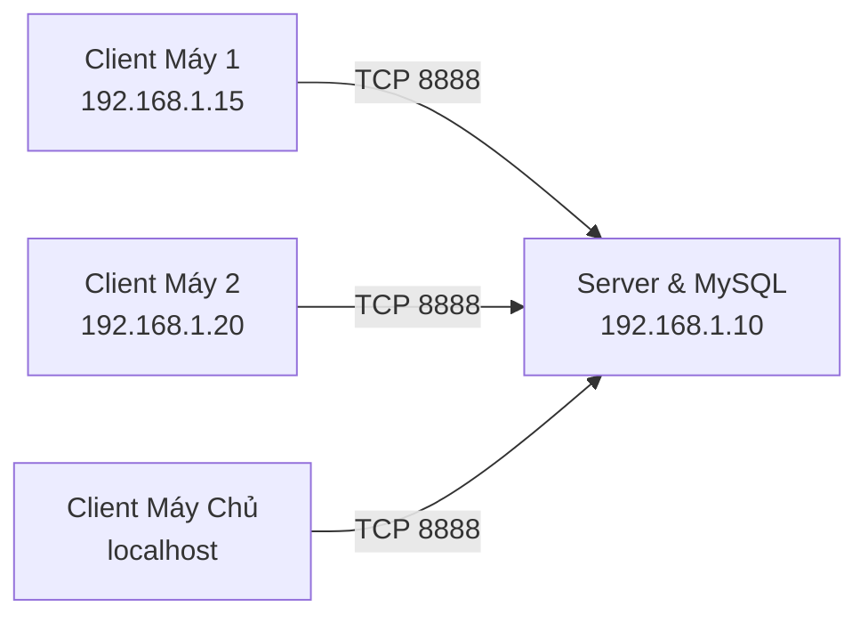

# ♠ Ba Cây Online

Trò chơi bài **Ba Cây Online** nhiều người chơi qua mạng nội bộ / LAN, được xây dựng trên nền tảng **Java 21**, giao diện đồ họa **Java Swing** thuần với phong cách đồ họa sang trọng (Royal Navy & Gold), kết nối mạng socket nhị phân tùy biến **Packet v2** bảo mật, và lưu trữ dữ liệu bền vững trên **MySQL 8.0+**.

---

## 📑 Mục Lục
1. [Điểm Nổi Bật](#-điểm-nổi-bật)
2. [Ngăn Xếp Công Nghệ (Tech Stack)](#-ngăn-xếp-công-nghệ-tech-stack)
3. [Cấu Trúc Thư Mục Dự Án](#-cấu-trúc-thư-mục-dự-án)
4. [Hướng Dẫn Cài Đặt Nhanh](#-hướng-dẫn-cài-đặt-nhanh)
5. [Thiết Lập Cơ Sở Dữ Liệu](#-thiết-lập-cơ-sở-dữ-liệu)
6. [Chơi Trong Mạng Nội Bộ (LAN / Wi-Fi)](#-chơi-trong-mạng-nội-bộ-lan--wi-fi)
7. [Biến Môi Trường & Cấu Hình Máy Chủ](#-biến-môi-trường--cấu-hình-máy-chủ)
8. [Đóng Gói & Xây Dựng Dự Án](#-đóng-gói--xây-dựng-dự-án)
9. [Xử Lý Lỗi Thường Gặp (Troubleshooting)](#-xử-lý-lỗi-thường-gặp-troubleshooting)
10. [Tài Liệu Kỹ Thuật Chi Tiết](#-tài-liệu-kỹ-thuật-chi-tiết)

---

## ✨ Điểm Nổi Bật

- **Giao diện Casino Royal Navy & Gold:** Thiết kế đồ họa Swing tỉ mỉ, khử răng cưa chất lượng cao (`bicubic` resampling), bảng nỉ xanh oval, ghế xoay 8 vị trí, avatar người chơi và hiệu ứng chia bài mượt mà.
- **Hệ thống 20 bàn chơi cố định:** Tự động đồng bộ hóa trạng thái phòng theo thời gian thực (trống, đang chờ, đang chơi, đủ người).
- **Luật Ba Cây hoàn chỉnh:** Xếp bài theo thứ tự Sáp > Liêng > Bồ Đội > Điểm; so chất theo thứ tự Việt Nam Rô ♦ > Cơ ♥ > Bích ♠ > Chuồn ♣.
- **Vòng cược thời gian thực:** Đầy đủ các thao tác Kiểm tra (Check), Theo (Call), Tố đến (Raise to), Tất tay (All-in), Úp bài (Fold).
- **Cơ chế bảo vệ bàn chơi:** Giới hạn thời gian suy nghĩ 30 giây/lượt (tự động úp bài khi hết giờ); tự động phân chia quỹ cược thành Pot chính và các Pot phụ (Side Pots) cho người chơi tất tay.
- **Chống gian lận (Zero Knowledge):** Máy chủ không bao giờ gửi thông tin bài của đối thủ về máy client cho đến vòng lật bài (Showdown).
- **Trang Quản Trị Độc Lập (Admin Portal):** Module `admin` Swing riêng biệt cho quản trị viên, cách ly hoàn toàn khỏi client người chơi. Giám sát 20 bàn chơi thời gian thực, quản lý & khóa tài khoản, điều chỉnh điểm số có kiểm toán, phát thông báo toàn server (Broadcast) và tra cứu sổ cái tài chính.
- **Bảo toàn dữ liệu đa tầng:** Giao dịch cơ sở dữ liệu ACID chống Deadlock, sổ cái kép kiểm toán (`play_ledger`, `admin_adjustments`), cùng cơ chế Write-Ahead Logging (WAL) tự động khôi phục kết quả ván bài nếu mất kết nối database.

---

## 🛠 Ngăn Xếp Công Nghệ (Tech Stack)

Dự án tuyệt đối tuân thủ ngăn xếp công nghệ thuần túy, không sử dụng framework trung gian cồng kềnh:

| Thành phần | Công nghệ / Thư viện | Mô tả |
|---|---|---|
| **Ngôn ngữ** | **Java 21 LTS** | Sử dụng Records, Pattern Matching, Sealed Interfaces, Virtual Threads ready |
| **Giao diện** | **Java Swing thuần & Java 2D** | Khử răng cưa, nạp asset bất đồng bộ, âm thanh stereo |
| **Quản lý dự án** | **Maven Multi-Module** | Gồm 4 module: `shared`, `server`, `client`, `admin` |
| **Giao thức mạng** | **Custom Binary Packet v2** | Gói tin nhị phân trên nền TCP Socket, bảo mật bằng `ObjectInputFilter` |
| **Cơ sở dữ liệu** | **MySQL 8.0.16+** | Pure JDBC với `mysql-connector-j`, giao dịch ACID với khóa `FOR UPDATE` |
| **Bảo mật mật khẩu** | **PBKDF2WithHmacSHA256** | Salt ngẫu nhiên 16 bytes, 600.000 vòng lặp |

---

## 📁 Cấu Trúc Thư Mục Dự Án

```
bacay-online/
├── client/                     # Module ứng dụng Swing Client
│   └── src/main/java/com/game3cay/
│       ├── RunClient.java      # Điểm khởi chạy Client
│       ├── controller/         # Điều phối sự kiện mạng và EDT Swing
│       ├── gui/                # Các thành phần giao diện (MainFrame, Table, Theme, Sound,...)
│       └── network/            # SocketClient bất đồng bộ với Worker Threads
├── admin/                      # Module ứng dụng Swing Admin Portal (Độc lập)
│   └── src/main/java/com/game3cay/admin/
│       ├── RunAdmin.java       # Điểm khởi chạy Admin
│       ├── controller/         # Điều phối sự kiện Admin & Polling scheduler
│       ├── gui/                # Giao diện quản trị (Dashboard, Users, Rooms, Ledger, Auth)
│       └── network/            # AdminSocketClient kết nối TCP Socket
├── server/                     # Module máy chủ Ba Cây Server
│   └── src/main/java/com/game3cay/server/
│       ├── ServerApplication.java # Điểm khởi chạy Server
│       ├── bus/                # Business Logic (UserBUS, GameBUS)
│       ├── dal/                # Data Access Layer & JDBC Connection Provider
│       ├── game/               # Luật bài (HandEvaluator, DefaultGameEngine, WAL)
│       ├── network/            # Quản lý phiên và phân luồng Socket TCP (ClientHandler)
│       └── room/               # Điều phối 20 bàn chơi (RoomManager)
├── shared/                     # Module dùng chung giữa Client & Server
│   └── src/main/java/com/game3cay/shared/
│       ├── model/              # Các Record DTOs (Card, Hand, Snapshots, Payloads)
│       ├── network/            # Định nghĩa Packet v2, PacketIO, ErrorCode
│       └── security/           # Tiện ích mã hóa mật khẩu PBKDF2
├── database/                   # Kịch bản cơ sở dữ liệu
│   └── setup.sql               # File duy nhất cài mới hoặc nâng cấp database
├── dist/                       # Thư mục chứa gói chạy sẵn đã được đóng gói
│   ├── client.jar              # JAR chạy Client
│   ├── admin.jar               # JAR chạy Admin Portal
│   ├── server.jar              # JAR chạy Server
│   ├── shared.jar              # Thư viện dùng chung
│   ├── lib/                    # Thư viện MySQL JDBC Driver
│   └── database/setup.sql      # Kịch bản SQL đi kèm gói chạy
├── docs/                       # Tài liệu kỹ thuật chuyên sâu
│   ├── Architecture.md         # Kiến trúc hệ thống, luồng dữ liệu & WAL
│   ├── Protocol.md             # Đặc tả gói tin nhị phân Packet v2 & ErrorCode
│   └── Database.md             # Thiết kế CSDL quan hệ, ERD & Chỉ mục
├── scripts/                    # Scripts tự động hóa Windows (Build & Run)
├── Game_Rules.md               # Quy định chi tiết luật chơi bài Ba Cây
├── Build.cmd                   # Script đóng gói dự án ra dist/ trên Windows
├── Start-Server.cmd            # Khởi chạy Server nhanh
├── Start-Client.cmd            # Khởi chạy Client nhanh
├── Start-Admin.cmd             # Khởi chạy Admin Portal nhanh
└── pom.xml                     # Maven Root Aggregator POM
```

---

## 🚀 Hướng Dẫn Cài Đặt Nhanh

### Yêu Cầu Môi Trường
1. **JDK 21 (LTS)** trở lên (kiểm tra bằng lệnh `java -version`).
2. **MySQL Community Server 8.0.16** trở lên (chỉ cần cài trên máy làm server).

### Bước 1: Khởi Tạo Cơ Sở Dữ Liệu
1. Mở công cụ quản trị (ví dụ: **MySQL Workbench** hoặc dòng lệnh `mysql`).
2. Mở file [`database/setup.sql`](file:///c:/Users/Tung%20Khanh%20Luong/Desktop/bacay-online/database/setup.sql).
3. Thực thi **toàn bộ file** (nhấn biểu tượng tia sét hoặc tổ hợp phím `Ctrl + Shift + Enter`).
4. Script sẽ tạo cơ sở dữ liệu `bacay_online`, các bảng và thiết lập số dư ban đầu 1.000 điểm cho người chơi.

### Bước 2: Chạy Máy Chủ (Server)
Nhấp đúp chuột vào file **`Start-Server.cmd`** tại thư mục gốc của dự án.
- Nhập mật khẩu MySQL của máy bạn khi được yêu cầu.
- Cửa sổ console sẽ hiển thị thông báo `[SERVER] Listening on 0.0.0.0:8888` sẵn sàng đón nhận kết nối.

### Bước 3: Chạy Ứng Dụng Người Chơi (Client)
Nhấp đúp chuột vào file **`Start-Client.cmd`**.
- Đăng ký tài khoản mới (tặng ngay 1.000 điểm giải trí) hoặc đăng nhập tài khoản có sẵn.
- Chọn một trong 20 bàn chơi tại sảnh và bấm **Sẵn sàng** để bắt đầu chơi.
- *Mẹo:* Bạn có thể mở nhiều cửa sổ `Start-Client.cmd` để thử nghiệm chơi đối kháng nhiều người trên cùng một máy tính.

### Bước 4: Chạy Trang Quản Trị (Admin Portal)
Nhấp đúp chuột vào file **`Start-Admin.cmd`**.
- **Tài khoản quản trị mặc định:**
  - Tên đăng nhập: `admin`
  - Mật khẩu: `admin@123`
- **Tính năng quản trị:**
  - **Dashboard:** Thống kê tổng số tài khoản, số người online, số bàn đang hoạt động, tổng điểm lưu hành và ván đấu hôm nay; phát thông báo toàn server.
  - **Quản lý người chơi:** Tìm kiếm, lọc theo vai trò/trạng thái, Khóa/Mở khóa tài khoản, điều chỉnh số dư kèm lý do kiểm toán.
  - **Giám sát bàn chơi:** Xem danh sách 20 bàn chơi, số người, pot hiện tại, trạng thái ván và nút buộc đặt lại bàn (Force Reset Room).
  - **Sổ cái tài chính:** Tra cứu toàn bộ lịch sử biến động số dư và thao tác điều chỉnh điểm của admin.

---

## 🌐 Chơi Trong Mạng Nội Bộ (LAN / Wi-Fi)

Hệ thống hỗ trợ chơi nhiều máy trong cùng một mạng LAN hoặc Wi-Fi văn phòng / gia đình:



1. **Trên máy chủ (Chạy Server):**
   - Mở Windows Firewall, tạo Inbound Rule cho phép cổng **TCP 8888**.
   - Tra cứu địa chỉ IPv4 của máy chủ bằng lệnh `ipconfig` (ví dụ: `192.168.1.10`).
   - Khởi chạy server bằng `Start-Server.cmd`.
2. **Trên các máy người chơi (Client):**
   - Mở ứng dụng bằng `Start-Client.cmd`.
   - Tại màn hình Đăng nhập, bấm vào nút **Máy chủ**, điền địa chỉ IPv4 của máy server (ví dụ: `192.168.1.10`) và cổng `8888`, sau đó bấm Lưu.
   - Hoặc khởi chạy nhanh bằng dòng lệnh:
     ```cmd
     Start-Client.cmd 192.168.1.10 8888
     ```

---

## ⚙ Biến Môi Trường & Cấu Hình Máy Chủ

Bạn có thể tùy biến cấu hình kết nối thông qua tham số dòng lệnh hoặc biến môi trường:

| Tên biến môi trường | Tham số dòng lệnh | Giá trị mặc định | Mô tả |
|---|---|---|---|
| `BACAY_DB_HOST` | `-DbHost` | `localhost` | Địa chỉ máy chủ MySQL |
| `BACAY_DB_PORT` | `-DbPort` | `3306` | Cổng kết nối MySQL |
| `BACAY_DB_NAME` | `-DbName` | `bacay_online` | Tên cơ sở dữ liệu |
| `BACAY_DB_USER` | `-DbUser` | `root` | Tên tài khoản MySQL |
| `BACAY_DB_PASSWORD` | `-DbPassword` | *(Hỏi lúc mở)* | Mật khẩu MySQL |
| `BACAY_SERVER_PORT` | `-Port` | `8888` | Cổng TCP Server lắng nghe |

Ví dụ khởi chạy Server với tài khoản MySQL riêng biệt:
```powershell
.\Start-Server.cmd -DbUser bacay_app -DbPassword "MySecurePass123" -Port 8888
```

---

## 📦 Đóng Gói & Xây Dựng Dự Án

Nếu có bất kỳ thay đổi nào trong mã nguồn Java, bạn có thể thực hiện build và đóng gói lại toàn bộ dự án:

### Trên Windows:
Nhấp đúp vào **`Build.cmd`** hoặc chạy trong PowerShell:
```powershell
powershell -NoProfile -ExecutionPolicy Bypass -File scripts\Build.ps1
```

### Trên Linux / macOS:
```bash
./mvnw clean install
```

Toàn bộ artifact sẽ được tự động biên dịch, chạy qua 29 bài kiểm thử đơn vị & tích hợp (Unit & Integration Tests), và sao chép đầy đủ các file chạy vào thư mục `dist/`.

---

## ❓ Xử Lý Lỗi Thường Gặp (Troubleshooting)

### 1. `Public Key Retrieval is not allowed`
- **Nguyên nhân:** MySQL 8.0 sử dụng cơ chế xác thực `caching_sha2_password` mà không bật TLS.
- **Cách khắc phục:** Chạy server với tham số:
  ```powershell
  .\Start-Server.cmd -DbUrl "jdbc:mysql://localhost:3306/bacay_online?allowPublicKeyRetrieval=true&useSSL=false"
  ```

### 2. `Address already in use: bind`
- **Nguyên nhân:** Cổng 8888 đang bị chiếm bởi một phiên bản server cũ đang chạy ngầm.
- **Cách khắc phục:** Đóng tất cả cửa sổ server cũ hoặc tìm và ngắt tiến trình Java qua Task Manager (hoặc lệnh `netstat -ano | findstr 8888`).

### 3. Client không kết nối được tới Server trong mạng LAN
- **Nguyên nhân:** Tường lửa Windows Defender trên máy server đang chặn kết nối đến cổng 8888.
- **Cách khắc phục:** Mở **Windows Defender Firewall with Advanced Security** $\rightarrow$ chọn **Inbound Rules** $\rightarrow$ Thêm rule cho phép **Port 8888 / TCP**.

---

## 📚 Tài Liệu Kỹ Thuật Chi Tiết

- 📖 [**Luật Chơi Ba Cây** (`Game_Rules.md`)](file:///c:/Users/Tung%20Khanh%20Luong/Desktop/bacay-online/Game_Rules.md): Quy định chi tiết về thứ bậc Sáp, Liêng, Bồ Đội, Điểm, cơ chế so chất Rô > Cơ > Bích > Chuồn và các mức cược.
- 🏛 [**Kiến Trúc Hệ Thống** (`docs/Architecture.md`)](file:///c:/Users/Tung%20Khanh%20Luong/Desktop/bacay-online/docs/Architecture.md): Sơ đồ phân tầng 3 module, mô hình phân luồng Swing EDT, giao dịch ACID và cơ chế Write-Ahead Log.
- 📡 [**Đặc Tả Giao Thức Mạng** (`docs/Protocol.md`)](file:///c:/Users/Tung%20Khanh%20Luong/Desktop/bacay-online/docs/Protocol.md): Chi tiết khung nhị phân Packet v2, bộ lọc tuần tự hóa `ObjectInputFilter`, sơ đồ tuần tự và bảng mã `ErrorCode`.
- 🗄 [**Thiết Kế Cơ Sở Dữ Liệu** (`docs/Database.md`)](file:///c:/Users/Tung%20Khanh%20Luong/Desktop/bacay-online/docs/Database.md): Sơ đồ ERD quan hệ thực thể, ràng buộc toàn vẹn dữ liệu, chống deadlock và kịch bản khởi tạo.
