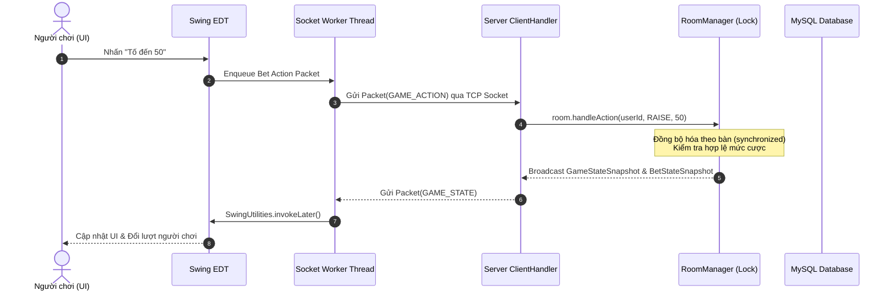
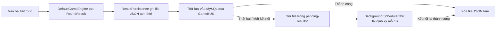

# Kiến Trúc Hệ Thống (Architecture)

Tài liệu này mô tả chi tiết kiến trúc tổng thể, mô hình luồng dữ liệu, chiến lược đồng thời và cơ chế bảo đảm an toàn dữ liệu của dự án **Ba Cây Online**.

---

## 1. Tổng Quan Kiến Trúc

Dự án tuân thủ mô hình **Client-Server hướng module (Maven Multi-Module)** với 4 module chính:

```mermaid
flowchart TD
    subgraph ClientModule ["Module: client (Java Swing GUI - Người chơi)"]
        UI[MainFrame / Swing Views] <--> CC[ConnectionController (EDT Confinement)]
        CC <--> SC[SocketClient (Dedicated Worker Threads)]
    end

    subgraph AdminModule ["Module: admin (Java Swing GUI - Quản trị viên)"]
        AUI[AdminMainFrame / Panels] <--> AC[AdminController (EDT & Poller)]
        AC <--> ASC[AdminSocketClient (Worker Threads)]
    end

    subgraph SharedModule ["Module: shared (Pure DTOs & Network Protocol)"]
        Packet[Packet v2 Protocol]
        Models[Model Records & Admin DTOs]
        Sec[PasswordUtil / PBKDF2]
    end

    subgraph ServerModule ["Module: server (Core Engine & Data Store)"]
        CH[ClientHandler / TCP Socket] <--> Guard[Admin Role Guard]
        Guard <--> SR[SessionRegistry / RoomManager]
        SR <--> GE[DefaultGameEngine & HandEvaluator]
        GE <--> RP[ResultPersistence (WAL Journal)]
        GE <--> GB[GameBUS / UserBUS]
        GB <--> DAO[UserDAO & Pure JDBC]
    end

    subgraph Storage ["Database / File System"]
        MySQL[(MySQL 8.0+ Database)]
        WAL[Pending Results Journal Files]
    end

    SC <== "Custom Binary Packet v2 (TCP Socket 8888)" ==> CH
    ASC <== "Admin Packets v2 (TCP Socket 8888)" ==> CH
    ClientModule -.-> SharedModule
    AdminModule -.-> SharedModule
    ServerModule -.-> SharedModule
    DAO <== "JDBC Connection Pool" ==> MySQL
    RP <== "Atomic File System Writes" ==> WAL
```

---

## 2. Phân Tách Module & Trách Nhiệm

### 2.1. Module `shared`
Là thư viện dùng chung cho cả Client và Server, không phụ thuộc vào bất kỳ framework bên ngoài nào:
- **`com.game3cay.shared.model`**:
  - Chứa các immutable data record: `Card`, `Hand`, `HandType`, `Rank`, `Suit`, `BetAction`, `RoomSnapshot`, `GameStateSnapshot`, `PlayerStateSnapshot`, `BetStateSnapshot`, `RoundResult`,...
  - Tất cả các payload truyền qua socket đều cài đặt `java.io.Serializable` kèm `@Serial private static final long serialVersionUID = 1L;`.
- **`com.game3cay.shared.network`**:
  - `Packet.java`: Cấu trúc gói tin nhị phân chuẩn hóa kèm header và kiểu gói tin `PacketType`.
  - `PacketIO.java`: Bộ đọc/ghi nhị phân socket tích hợp bảo mật lọc đối tượng `ObjectInputFilter` nghiêm ngặt theo whitelist.
  - `ErrorCode.java`: Enum định danh chuẩn toàn bộ mã lỗi hệ thống (Network, Auth, Room, Game, Validation).
  - `RuntimeSettings.java`: Đọc cấu hình từ properties/environment.
- **`com.game3cay.shared.security`**:
  - `PasswordUtil.java`: Băm mật khẩu bằng PBKDF2WithHmacSHA256 với Salt 16 bytes và 600.000 vòng lặp.

### 2.2. Module `server`
Thực thi toàn bộ logic điều khiển, luật chơi bài, quản lý phòng và giao dịch cơ sở dữ liệu:
- **`com.game3cay.server.dal` (Data Access Layer)**:
  - `ConnectionProvider.java`: Quản lý pool kết nối JDBC tự chế, cấu hình tham số thời gian chờ và kết nối lại tự động.
  - `DatabaseConfig.java`: Phân tích biến môi trường/tham số dòng lệnh (`BACAY_DB_HOST`, `BACAY_DB_PORT`, `BACAY_DB_USER`, `BACAY_DB_PASSWORD`,...).
  - `UserDAO.java`: Truy vấn thuần PreparedStatement với `users`.
- **`com.game3cay.server.bus` (Business Logic Layer)**:
  - `UserBUS.java` / `JdbcUserBUS.java`: Nghiệp vụ xác thực người dùng, đăng ký, cập nhật hồ sơ, bảo toàn điểm số.
  - `GameBUS.java` / `JdbcGameBUS.java`: Nghiệp vụ ghi nhận ván bài, cập nhật số dư có giao dịch ACID, ghi sổ cái kép (`play_ledger`), phân trang lịch sử và bảng xếp hạng.
- **`com.game3cay.server.game` (Game Rules & Settlement)**:
  - `HandEvaluator.java`: Bộ giải thuật tính điểm và phân loại tổ hợp bài: Sáp > Liêng > Bồ Đội > Điểm, cùng cơ chế so chất Rô > Cơ > Bích > Chuồn.
  - `DefaultGameEngine.java`: Quản lý tiến trình ván bài, chia bài từ bộ 52 lá đã xáo trộn, tính toán pot chính và các pot phụ (side pots) cho người chơi tất tay, kiểm soát lượt tố.
  - `ResultPersistence.java`: Cơ chế Write-Ahead Logging (WAL) ghi kết quả ván bài vào file trước khi lưu vào DB, có luồng thử lại nền khi DB gặp sự cố.
- **`com.game3cay.server.network`**:
  - `ServerApplication.java`: Entry point, kiểm tra cấu trúc bảng MySQL và mở ServerSocket lắng nghe.
  - `ClientHandler.java`: Tiếp nhận kết nối, phân luồng socket cho từng client, nhận và phát gói tin.
  - `SessionRegistry.java`: Quản lý phiên đăng nhập trực tuyến, ngăn chặn đăng nhập đồng thời từ nhiều máy.
- **`com.game3cay.server.room`**:
  - `RoomManager.java`: Quản lý 20 bàn chơi cố định, điều phối chỗ ngồi, trạng thái sẵn sàng, turn timeout (30 giây tự động úp bài).

### 2.3. Module `client`
Ứng dụng giao diện đồ họa người chơi bằng Java Swing với phong cách Casino Royal Navy & Gold:
- **`com.game3cay.RunClient.java`**: Khởi chạy ứng dụng client, cấu hình khử răng cưa chữ và đồ họa (`swing.aatext`).
- **`com.game3cay.controller.ConnectionController`**:
  - Controller duy nhất của client, đảm bảo phân định rõ ràng giữa luồng I/O socket và luồng Swing Event Dispatch Thread (EDT).
  - Định tuyến các gói tin server tới đúng màn hình hiển thị.
- **`com.game3cay.gui`**:
  - `MainFrame.java`: Khung cửa sổ chính, quản lý chuyển đổi CardLayout (Đăng nhập, Sảnh 20 bàn, Bàn chơi).
  - `AuthPanel.java`: Màn hình đăng nhập / đăng ký / cài đặt IP server.
  - `LobbyPanel.java`: Hiển thị danh sách 20 bàn chơi kèm số lượng người chơi theo thời gian thực.
  - `RoomPanel.java`: Khung bàn chơi, tích hợp thanh chat, lịch sử chat và các nút điều khiển.
  - `GamePanel.java`: Bảng điều khiển hành động cược (Theo, Tố đến, Tất tay, Úp bài, Ẩn/Hiện bài).
  - `GameTablePanel.java`: Đồ họa bàn nỉ xanh oval, avatar 8 vị trí ghế ngồi, thanh đếm ngược thời gian lượt (30s), và hoạt ảnh lật bài.
  - `DataDialog.java`: Hộp thoại xem lịch sử ván đấu và bảng xếp hạng người chơi có phân trang.
  - `Theme.java` / `Assets.java` / `Sound.java`: Bảng mã màu tùy biến, bộ nạp tài nguyên đồ họa và bộ phát âm thanh bất đồng bộ.

### 2.4. Module `admin`
Ứng dụng giao diện quản trị viên độc lập bằng Java Swing (được tách hoàn toàn khỏi `client.jar` để bảo mật triệt để):
- **`com.game3cay.admin.RunAdmin.java`**: Khởi chạy ứng dụng Admin với thiết lập khử răng cưa.
- **`com.game3cay.admin.controller.AdminController`**:
  - Điều phối các tác vụ quản trị, gửi/nhận yêu cầu qua `AdminSocketClient` với `CompletableFuture`.
  - Bộ lập lịch `ScheduledExecutorService` định kỳ mỗi 5 giây tự động làm mới số liệu Dashboard và trạng thái 20 bàn chơi trên luồng Swing EDT.
- **`com.game3cay.admin.network.AdminSocketClient`**:
  - Quản lý kết nối socket tới server, xử lý cơ chế request-response thông qua correlation map và bắt các gói tin phát thanh (broadcast).
- **`com.game3cay.admin.gui`**:
  - `AdminMainFrame.java`: Khung điều hướng chính với thanh tiêu đề, menu chức năng và trạng thái phiên quản trị.
  - `AdminAuthPanel.java`: Màn hình kết nối server và xác thực tài khoản quản trị viên.
  - `DashboardPanel.java`: 5 thẻ KPI trực quan thời gian thực (Tài khoản, Online, Bàn hoạt động, Tổng điểm, Ván hôm nay) và khung phát thông báo toàn server.
  - `UsersPanel.java`: Danh sách người dùng phân trang, tìm kiếm theo username/display name, lọc theo vai trò & trạng thái, Khóa/Mở khóa tài khoản và hộp thoại điều chỉnh số dư kèm lý do kiểm toán.
  - `RoomsPanel.java`: Giám sát toàn bộ 20 bàn chơi (Số người, cược sàn, Pot hiện tại, trạng thái ván), cùng nút buộc đặt lại bàn bị treo (Force Reset Room).
  - `LedgerPanel.java`: Nhật ký biến động tài chính phân trang, theo dõi chi tiết cả tiền cược ván bài lẫn biến động do Admin điều chỉnh.
  - `AdminTheme.java`: Thư viện giao diện đồng bộ phong cách Royal Navy & Gold sang trọng.

### 2.5. Cơ Chế Bảo Vệ & Phân Quyền (Role Guard)
- **Tách biệt nhị phân (Binary Isolation):** Mã nguồn Admin nằm riêng trong module `admin`, đóng gói thành `admin.jar`. Người chơi khi nhận file `client.jar` hoàn toàn không thể decompile hay tái sử dụng giao diện quản trị.
- **Xác thực tầng máy chủ (`requireAdminUser()`):** Tại `ClientHandler.java`, mọi gói tin thuộc nhóm Admin (`0x2D` – `0x38`) đều được kiểm tra nghiêm ngặt thông qua phiên đăng nhập hiện tại:
  ```java
  private UserDTO requireAdminUser() throws BUSException {
      UserDTO u = currentUser;
      if (u == null || !"ADMIN".equalsIgnoreCase(u.role())) {
          throw new BUSException(ErrorCode.FORBIDDEN, "Yêu cầu quyền quản trị viên");
      }
      return u;
  }
  ```
  Nếu tài khoản có vai trò `USER` hoặc chưa đăng nhập gửi gói tin admin, máy chủ lập tức phản hồi gói tin `ERROR_RESP` với mã lỗi `ErrorCode.FORBIDDEN`.

---

## 3. Mô Hình Luồng & Tính Đồng Thời (Concurrency)



### 3.1. Phía Client
- **Ranh giới EDT (Swing Confinement)**: Mọi thao tác cập nhật giao diện đồ họa đều bắt buộc chạy trên luồng EDT thông qua `SwingUtilities.invokeLater()`.
- **Worker Thread độc lập**: `SocketClient` duy trì 2 luồng riêng biệt:
  - `Reader Thread`: Chuyên đọc gói tin nhị phân từ socket và đẩy sự kiện cho `ConnectionController`.
  - `Sender Thread`: Nhận gói tin từ hàng đợi nội bộ (`LinkedBlockingQueue`) và ghi vào socket, không làm treo giao diện người dùng.

### 3.2. Phía Server
- **Mỗi Client một luồng I/O (`ClientHandler`)**: Xử lý đọc tuần tự các gói tin từ socket của client đó.
- **Đồng bộ hóa Bàn chơi (`RoomManager`)**:
  - Mỗi bàn chơi là một thực thể độc lập được bảo vệ bởi khóa đồng bộ hóa (`synchronized (room)`).
  - Các thao tác vào bàn, rời bàn, đặt cược, chuyển lượt đều diễn ra tuần tự và an toàn trên từng bàn, không gây nghẽn giữa các bàn khác nhau.
- **Bộ đếm thời gian Turn Timeout**:
  - Luồng scheduler ngầm định kỳ mỗi 1 giây (`ScheduledExecutorService`) kiểm tra thời gian suy nghĩ của người chơi hiện tại.
  - Nếu quá 30 giây kể từ thời điểm bắt đầu lượt, hệ thống tự động thực hiện hành động `FOLD` (Úp bài) để giải phóng bàn chơi.

---

## 4. Giao Dịch Cơ Sở Dữ Liệu & Chống Deadlock

Toàn bộ thao tác thanh toán tiền cược và ghi nhận kết quả cuối ván được thực hiện trong một **Transaction ACID duy nhất** tại `JdbcGameBUS.recordRoundResult()`:

1. **Khóa bản ghi người chơi (`SELECT ... FOR UPDATE`)**:
   - Để ngăn ngừa Deadlock khi nhiều ván bài hoàn tất cùng lúc hoặc người chơi cùng tham gia giao dịch, hệ thống thực hiện sắp xếp danh sách `user_id` theo thứ tự tăng dần (**Deterministic Lock Ordering**):
   ```java
   List<Long> sortedUserIds = playerResults.stream()
           .map(PlayerRoundOutcome::userId)
           .sorted()
           .toList();
   ```
2. **Kiểm tra ghi trùng ván (`Idempotency`)**:
   - Kiểm tra `play_rounds.id` trước khi chèn. Nếu ván bài đã được ghi, transaction lập tức hủy bỏ để tránh cộng/trừ điểm lặp lại.
3. **Cập nhật số dư & Ghi sổ cái kép (`Audit Ledger`)**:
   - Mỗi biến động số dư (`profit`) đều được ghi một dòng tương ứng vào bảng `play_ledger`.
   - Tổng biến động của tất cả người chơi trong ván luôn được kiểm tra cân bằng với tiền thưởng và tiền cược (Zero-Sum check).

---

## 5. Cơ Chế Khôi Phục Write-Ahead Logging (WAL)

Để đảm bảo không mất mát kết quả ván đấu khi MySQL gặp sự cố kết nối đột xuất:



- Thư mục lưu trữ: `dist/data/pending-results/` (hoặc `server/data/pending-results/`).
- Ghi nguyên tử: Ghi dữ liệu ra file `.tmp` trước, sau đó dùng `Files.move(..., ATOMIC_MOVE)` sang định dạng `.json` để tránh lỗi hỏng file nếu server tắt đột ngột lúc đang ghi.
- Khi server khởi động lại, `ResultPersistence.recoverPending()` tự động quét thư mục và nạp lại toàn bộ các ván chưa lưu để ghi bổ sung vào database.
