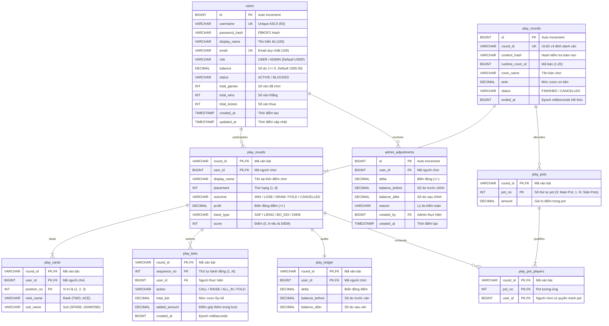

# Thiết Kế Cơ Sở Dữ Liệu (Database Schema)

Tài liệu này đặc tả chi tiết lược đồ cơ sở dữ liệu quan hệ **MySQL 8.0.16+** của hệ thống **Ba Cây Online**, các ràng buộc toàn vẹn, chỉ mục tối ưu hóa và quy trình di chuyển dữ liệu.

---

## 1. Sơ Đồ Quan Hệ Thực Thể (ERD)



---

## 2. Chi Tiết Các Bảng & Ràng Buộc

### 2.1. Bảng `users` (Tài khoản & Số dư)
Lưu trữ định danh người chơi, mật khẩu bảo mật và điểm số giải trí:
- `id`: Khóa chính tự tăng (`BIGINT NOT NULL AUTO_INCREMENT`).
- `username`: Tên đăng nhập duy nhất (`VARCHAR(50) NOT NULL UNIQUE`).
- `password_hash`: Chuỗi mã hóa dạng `pbkdf2:sha256:600000:<salt_b64>:<hash_b64>`.
- `role`: Vai trò tài khoản (`VARCHAR(20) NOT NULL DEFAULT 'USER'`).
  - *Ràng buộc:* `CONSTRAINT ck_users_role CHECK (role IN ('USER', 'ADMIN'))`.
- `balance`: Điểm số khả dụng (`DECIMAL(15,2) NOT NULL DEFAULT 1000.00`).
  - *Ràng buộc:* `CONSTRAINT ck_users_balance CHECK (balance >= 0)`.
- `status`: Trạng thái hoạt động (`ACTIVE` hoặc `BLOCKED`).
- Thống kê: `total_games`, `total_wins`, `total_losses` (ràng buộc `>= 0`).

### 2.2. Bảng `play_rounds` (Phiên Ván Bài)
Lưu trữ thông tin tổng quát của từng ván bài đã kết thúc hoặc bị hủy:
- `round_id`: Định danh duy nhất toàn hệ thống dạng UUID v4 (`VARCHAR(64) NOT NULL UNIQUE`).
- `ante`: Mức cược sàn cơ bản của bàn tại thời điểm chia bài.
- `status`: Trạng thái kết thúc:
  - `FINISHED`: Ván bài hoàn tất và có thanh toán.
  - `CANCELLED`: Ván bài bị hủy (ví dụ không còn đủ người chơi) và hoàn điểm đầy đủ cho các bên.
- `ended_at`: Thời điểm kết thúc tính theo Epoch Milliseconds (`BIGINT`).

### 2.3. Bảng `play_results` (Kết Quả Ván Bài Của Từng Người)
- Khóa chính kết hợp: `(round_id, user_id)`.
- `outcome`: Kết quả (`WIN`, `LOSE`, `DRAW`, `FOLD`, `CANCELLED`).
- `profit`: Số điểm nhận được hoặc mất đi (`DECIMAL(15,2)`). Có thể là số âm hoặc dương.
- `hand_type` & `score`: Phân loại bài (`SAP`, `LIENG`, `BO_DOI`, `DIEM`) và điểm số (0–9).
- Chỉ mục: `INDEX ix_play_history (user_id, round_id)` giúp truy vấn phân trang lịch sử cá nhân đạt hiệu năng tối đa.

### 2.4. Bảng `play_cards` (Chi Tiết Từng Lá Bài)
- Lưu trữ chính xác 3 lá bài được chia cho từng người chơi.
- Khóa chính kết hợp: `(round_id, user_id, position_no)` với `position_no IN (1, 2, 3)`.
- Ràng buộc bài không trùng: `UNIQUE (round_id, rank_name, suit_name)` đảm bảo tính trung thực tuyệt đối trong một ván không bao giờ xuất hiện hai lá bài giống nhau từ bộ 52 lá.

### 2.5. Bảng `play_bets` (Nhật Ký Đặt Cược)
- Ghi nhận chi tiết từng thao tác đặt cược theo dòng thời gian.
- Khóa chính: `(round_id, sequence_no)`.
- `action`: Hành động (`CALL`, `RAISE`, `ALL_IN`, `FOLD`).
- `added_amount`: Số điểm người chơi phải bỏ thêm từ tài khoản trong lượt này.

### 2.6. Bảng `play_pots` & `play_pot_players` (Cấu Trúc Pot Phụ)
- Khi có người chơi **Tất tay (All-in)** với số dư nhỏ hơn mức cược cao nhất của bàn, hệ thống tự động phân tách thành **Pot chính (pot_no = 0)** và các **Pot phụ (pot_no >= 1)**.
- `play_pot_players` xác định danh sách các ứng viên hợp lệ đủ điều kiện tranh phần thưởng của pot tương ứng.

### 2.7. Bảng `play_ledger` (Sổ Cái Kép Kiểm Toán Điểm Số)
Lưu vết kiểm toán cho mọi biến động số dư tài khoản do chơi bài:
- Ràng buộc tính toán bất biến:
  - `CHECK (balance_after >= 0)`
  - `CHECK (balance_after = balance_before + delta)`

### 2.8. Bảng `admin_adjustments` (Sổ Cái Can Thiệp Của Quản Trị Viên)
Ghi nhận đầy đủ vết kiểm toán mọi hành động cộng/trừ điểm thủ công của Admin:
- `id`: Khóa chính tự tăng (`BIGINT NOT NULL AUTO_INCREMENT`).
- `user_id`: Khóa ngoại tham chiếu đến `users(id)` của người chơi được điều chỉnh.
- `delta`: Mức thay đổi điểm số (dương nếu cộng điểm, âm nếu trừ điểm).
- `balance_before` & `balance_after`: Số dư trước và sau can thiệp (`balance_after = balance_before + delta`).
- `reason`: Lý do bắt buộc khi Admin thực hiện thao tác (tối đa 255 ký tự).
- `created_by`: ID tài khoản Admin thực hiện thao tác.
- `created_at`: Thời điểm ghi nhận (`TIMESTAMP DEFAULT CURRENT_TIMESTAMP`).

---

## 3. Quản Lý Đồng Thời & Mức Cô Lập (Transaction Isolation)

1. **Mức cô lập**: Mặc định sử dụng **READ COMMITTED** hoặc **REPEATABLE READ** của InnoDB.
2. **Chiến lược khóa phòng tránh Deadlock**:
   - Khi hoàn tất ván, server mở một giao dịch duy nhất (`START TRANSACTION`).
   - Danh sách các tài khoản người chơi trong ván bài được sắp xếp tăng dần theo ID (`ORDER BY user_id ASC`).
   - Thực thi khóa đọc ghi bằng cú pháp:
     ```sql
     SELECT balance FROM users WHERE id = ? FOR UPDATE;
     ```
   - Việc sắp xếp cố định thứ tự khóa đảm bảo không bao giờ xảy ra tình trạng chu trình chờ lẫn nhau giữa các giao dịch đồng thời.

---

## 4. Hướng Dẫn Cài Đặt & Nâng Cấp Schema

Toàn bộ cấu trúc bảng và thủ tục khởi tạo được đóng gói trong một file SQL duy nhất:
👉 [`database/setup.sql`](file:///c:/Users/Tung%20Khanh%20Luong/Desktop/bacay-online/database/setup.sql)

### Các đặc điểm an toàn:
- Tính chất **Idempotent** (chạy lại nhiều lần không sinh lỗi nhờ `CREATE TABLE IF NOT EXISTS`).
- Giữ nguyên toàn bộ tài khoản và lịch sử hiện có trong cơ sở dữ liệu `bacay_online`.
- Tự động di chuyển dữ liệu (Migration) bổ sung cột `role` và bảng `admin_adjustments` thông qua Stored Procedure an toàn `bacay_migration_add_role`.
- Tự động gieo tài khoản Admin quản trị mặc định:
  - **Tên đăng nhập:** `admin`
  - **Mật khẩu:** `admin@123` (băm PBKDF2WithHmacSHA256, 600.000 vòng lặp)
  - **Vai trò:** `ADMIN`
- Tự động cấp 1.000 điểm khởi tạo cho các tài khoản cũ có số dư 0 điểm thông qua cơ chế bảng migration `app_migrations`.
