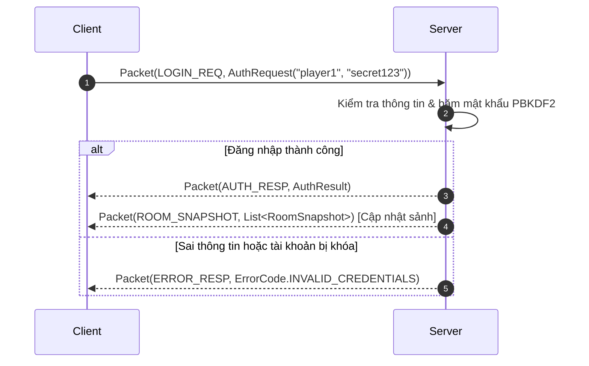
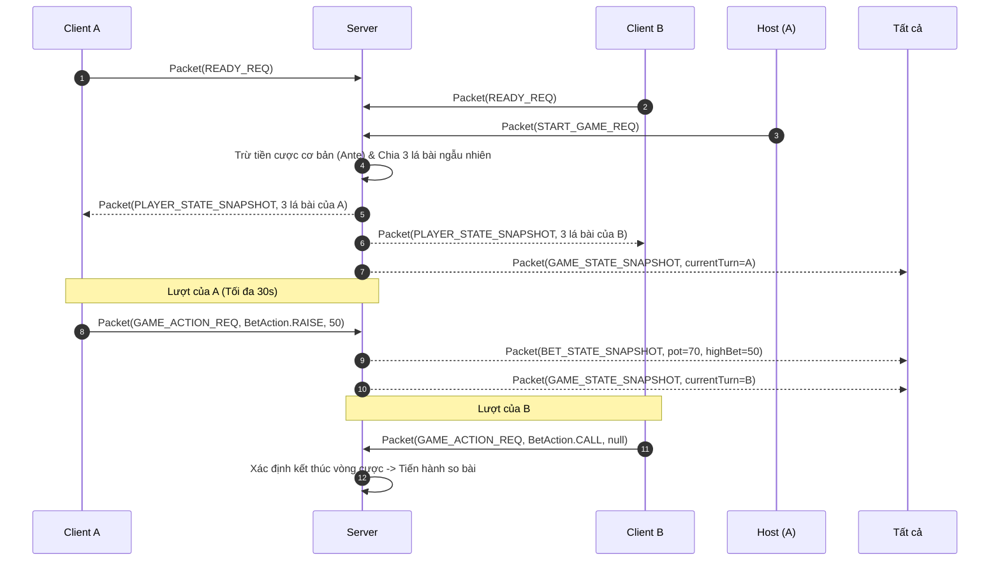
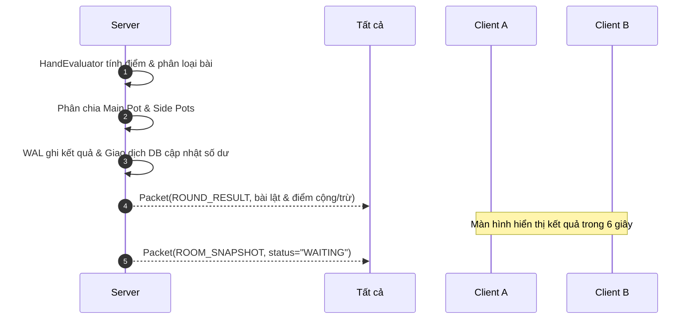
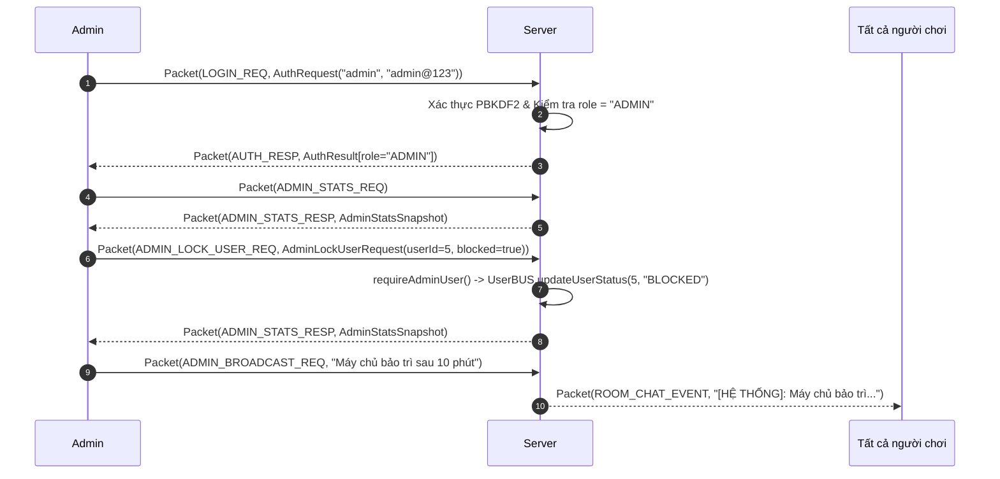

# Đặc Tả Giao Thức Mạng (Protocol Specification)

Tài liệu này định nghĩa cấu trúc gói tin nhị phân **Packet v2**, danh mục thông điệp, các luồng tương tác và mã lỗi trong hệ thống **Ba Cây Online**.

---

## 1. Cấu Trúc Khung Nhị Phân (Packet v2 Frame)

Giao thức Packet v2 hoạt động trực tiếp trên tầng **TCP Socket**. Mỗi gói tin bao gồm một Header cố định 8 bytes theo sau bởi Payload nhị phân đã serialize:

```
+---------------+---------------+---------------+---------------+---------------+---------------+---------------+---------------+
| Byte 0        | Byte 1        | Byte 2        | Byte 3        | Byte 4        | Byte 5        | Byte 6        | Byte 7        |
+---------------+---------------+---------------+---------------+---------------+---------------+---------------+---------------+
|      MAGIC (2 bytes)          |  VER (1 byte) | TYPE (1 byte) |              PAYLOAD LENGTH (4 bytes, Big-Endian)             |
|   0x3C        |   0x33        |     0x02      |  0x01 .. 0x38 |              0 .. 10,485,760 bytes (Max 10MB)                 |
+---------------+---------------+---------------+---------------+---------------+---------------+---------------+---------------+
|                                      PAYLOAD (Java Serialized Object Stream)                                                  |
|                                                     N bytes                                                           |
+---------------+---------------+---------------+---------------+---------------+---------------+---------------+---------------+
```

### Chi tiết Header:
| Trường | Kích thước | Kiểu dữ liệu | Giá trị quy ước | Ý nghĩa |
|---|---|---|---|---|
| **Magic Bytes** | 2 bytes | Byte array | `0x3C 0x33` (`<3`) | Định danh gói tin hợp lệ của Ba Cây Online |
| **Protocol Version** | 1 byte | Unsigned byte | `0x02` | Phiên bản giao thức (Version 2) |
| **Packet Type** | 1 byte | Byte | `0x01` – `0x38` | Mã định danh loại thông điệp (xem bảng bên dưới) |
| **Payload Length** | 4 bytes | Int (Big-Endian) | `0` – `10,485,760` | Độ dài của dữ liệu Payload (tối đa 10 MB) |
| **Payload** | N bytes | Byte stream | Tuân thủ whitelist | Đối tượng Java Serialization chứa thông tin nghiệp vụ |

---

## 2. Bảo Mật Tuần Tự Hóa (ObjectInputFilter)

Để triệt tiêu hoàn toàn rủi ro tấn công **Java Deserialization Gadget Chain**, lớp `PacketIO` áp dụng `java.io.ObjectInputFilter` kiểm duyệt chặt chẽ:

```java
ObjectInputFilter filter = ObjectInputFilter.Config.createFilter(
    "com.game3cay.shared.model.*;" +
    "java.lang.String;" +
    "java.lang.Number;" +
    "java.lang.Long;" +
    "java.lang.Integer;" +
    "java.lang.Boolean;" +
    "java.math.BigDecimal;" +
    "java.math.BigInteger;" +
    "java.util.*;" +
    "!*" // Từ chối tất cả các lớp ngoài danh mục cho phép
);
```

Bất kỳ gói tin nào chứa lớp nằm ngoài whitelist sẽ bị ngắt kết nối ngay lập tức tại tầng mạng.

---

## 3. Danh Mục PacketType

### 3.1. Phía Client gửi Server (C2S)
| PacketType | Mã Hex | Payload Type | Mô tả chức năng |
|---|---|---|---|
| `LOGIN_REQ` | `0x01` | `AuthRequest` | Yêu cầu đăng nhập tài khoản |
| `REGISTER_REQ` | `0x02` | `RegisterRequest` | Yêu cầu đăng ký tài khoản mới |
| `JOIN_ROOM_REQ` | `0x03` | `JoinRoomRequest` | Yêu cầu vào một bàn chơi (1–20) |
| `LEAVE_ROOM_REQ` | `0x04` | `null` | Rời khỏi bàn chơi hiện tại |
| `GAME_ACTION_REQ` | `0x05` | `GameActionRequest` | Hành động trong ván (CALL, RAISE, ALL_IN, FOLD) |
| `START_GAME_REQ` | `0x06` | `null` | Chủ bàn yêu cầu bắt đầu ván bài mới |
| `READY_REQ` | `0x07` | `null` | Bật/tắt trạng thái sẵn sàng trong bàn |
| `UPDATE_ANTE_REQ` | `0x08` | `BigDecimal` | Chủ bàn thay đổi mức cược cơ bản |
| `ROOM_CHAT_REQ` | `0x09` | `String` | Gửi tin nhắn chat trong bàn |
| `PROFILE_REQ` | `0x0A` | `null` | Yêu cầu lấy thông tin hồ sơ cá nhân |
| `UPDATE_PROFILE_REQ` | `0x0B` | `UpdateProfileRequest` | Cập nhật tên hiển thị và email |
| `CHANGE_PASSWORD_REQ` | `0x0C` | `ChangePasswordRequest` | Đổi mật khẩu tài khoản |
| `PLAY_AGAIN_REQ` | `0x0D` | `Boolean` | Xác nhận tiếp tục chơi sau khi kết thúc ván |
| `GAME_HISTORY_REQ` | `0x0E` | `PageRequest` | Tra cứu lịch sử ván bài (phân trang) |
| `LEADERBOARD_REQ` | `0x0F` | `PageRequest` | Tra cứu bảng xếp hạng người chơi (phân trang) |
| `HEARTBEAT_PING` | `0x2A` | `null` | Giữ kết nối socket (gửi định kỳ mỗi 15s) |

### 3.2. Phía Server phản hồi Client (S2C)
| PacketType | Mã Hex | Payload Type | Mô tả chức năng |
|---|---|---|---|
| `AUTH_RESP` | `0x15` | `AuthResult` | Trả về kết quả đăng nhập / đăng ký thành công |
| `ROOM_SNAPSHOT` | `0x16` | `RoomSnapshot` | Trạng thái toàn bộ bàn (chủ bàn, danh sách ghế, cược) |
| `GAME_STATE_SNAPSHOT` | `0x17` | `GameStateSnapshot` | Tiến trình ván bài, người đang có lượt, thời gian |
| `PLAYER_STATE_SNAPSHOT` | `0x18` | `PlayerStateSnapshot` | Bài riêng của người chơi và số dư cá nhân |
| `BET_STATE_SNAPSHOT` | `0x19` | `BetStateSnapshot` | Tổng tiền cược trên bàn, cược của từng người |
| `ROUND_RESULT` | `0x1A` | `RoundResult` | Kết quả ván bài (thắng/thua, bài lật, điểm cộng/trừ) |
| `ROOM_CHAT_EVENT` | `0x1B` | `RoomChatEvent` | Broadcast tin nhắn chat trong phòng |
| `PROFILE_RESP` | `0x1C` | `ProfileResult` | Thông tin hồ sơ, thống kê thắng/thua |
| `PAGE_RESULT` | `0x1D` | `PageResult<?>` | Dữ liệu danh sách phân trang (Lịch sử hoặc BXH) |
| `PLAY_AGAIN_PROMPT` | `0x1E` | `PlayAgainPrompt` | Hộp thoại nhắc nhở chơi tiếp sau ván |
| `ERROR_RESP` | `0x28` | `ErrorCode` | Thông báo lỗi nghiệp vụ hoặc kỹ thuật |
| `HEARTBEAT_PONG` | `0x2B` | `null` | Phản hồi xác nhận kết nối còn sống |

### 3.3. Nhóm Giao Thức Quản Trị Viên (Admin Protocol)
| PacketType | Mã Hex | Chiều | Payload Type | Mô tả chức năng |
|---|---|---|---|---|
| `ADMIN_STATS_REQ` | `0x2D` | C $\rightarrow$ S | `null` | Yêu cầu lấy số liệu thống kê tổng quan hệ thống |
| `ADMIN_STATS_RESP` | `0x2E` | S $\rightarrow$ C | `AdminStatsSnapshot` | Trả về tổng user, online, bàn chạy, số dư, ván đấu |
| `ADMIN_USERS_PAGE_REQ` | `0x2F` | C $\rightarrow$ S | `AdminUserFilterRequest` | Yêu cầu danh sách tài khoản kèm bộ lọc tìm kiếm & phân trang |
| `ADMIN_USERS_PAGE_RESP` | `0x30` | S $\rightarrow$ C | `PageResult<AdminUserItem>` | Trả về trang dữ liệu danh sách người dùng cho Admin |
| `ADMIN_LOCK_USER_REQ` | `0x31` | C $\rightarrow$ S | `AdminLockUserRequest` | Yêu cầu khóa (`BLOCKED`) hoặc mở khóa (`ACTIVE`) tài khoản |
| `ADMIN_ADJUST_BALANCE_REQ`| `0x32` | C $\rightarrow$ S | `AdminAdjustBalanceRequest` | Cộng/trừ điểm số người dùng kèm lý do kiểm toán |
| `ADMIN_ROOMS_MONITOR_REQ` | `0x33` | C $\rightarrow$ S | `null` | Yêu cầu giám sát chi tiết trạng thái 20 bàn chơi |
| `ADMIN_ROOMS_MONITOR_RESP`| `0x34` | S $\rightarrow$ C | `List<AdminRoomDetail>` | Trả về danh sách chi tiết 20 bàn chơi kèm pot và người chơi |
| `ADMIN_FORCE_RESET_ROOM` | `0x35` | C $\rightarrow$ S | `AdminResetRoomRequest` | Buộc đặt lại bàn bị treo hoặc có tranh chấp |
| `ADMIN_BROADCAST_REQ` | `0x36` | C $\rightarrow$ S | `AdminBroadcastRequest` | Phát thông báo khẩn cấp tới tất cả bàn chơi đang mở |
| `ADMIN_LEDGER_PAGE_REQ` | `0x37` | C $\rightarrow$ S | `PageRequest` | Yêu cầu tra cứu sổ cái tài chính tổng thể có phân trang |
| `ADMIN_LEDGER_PAGE_RESP` | `0x38` | S $\rightarrow$ C | `PageResult<AdminLedgerItem>` | Trả về trang dữ liệu sổ cái biến động số dư và điều chỉnh |

---

## 4. Các Luồng Tuần Tự (Sequence Diagrams)

### 4.1. Luồng Xác Thực (Login / Register)



### 4.2. Luồng Bàn Chơi & Vòng Cược



### 4.3. Luồng Kết Thúc & So Bài (Showdown)



### 4.4. Luồng Quản Trị Viên (Admin Flow)



---

## 5. Bảng Danh Mục Mã Lỗi (ErrorCode)

| ErrorCode | Nhóm | Ý nghĩa |
|---|---|---|
| `SUCCESS` | Chung | Thao tác thực hiện thành công |
| `INTERNAL_ERROR` | Chung | Lỗi máy chủ không xác định |
| `INVALID_PAYLOAD` | Chung | Dữ liệu gói tin không đúng định dạng |
| `FORBIDDEN` | Phân quyền | Không có quyền thực hiện thao tác (chỉ dành cho Admin) |
| `INVALID_CREDENTIALS` | Xác thực | Tên đăng nhập hoặc mật khẩu không chính xác |
| `USERNAME_ALREADY_EXISTS` | Xác thực | Tên tài khoản đã có người sử dụng |
| `USER_NOT_FOUND` | Xác thực | Tài khoản không tồn tại |
| `SESSION_EXPIRED` | Xác thực | Phiên làm việc đã hết hạn hoặc bị ngắt |
| `ALREADY_LOGGED_IN` | Xác thực | Tài khoản đang được đăng nhập ở thiết bị khác |
| `PASSWORD_TOO_WEAK` | Xác thực | Mật khẩu không đáp ứng độ an toàn (tối thiểu 8 ký tự) |
| `ROOM_FULL` | Bàn chơi | Bàn đã đủ số lượng người chơi tối đa (8 người) |
| `ROOM_NOT_FOUND` | Bàn chơi | Bàn chơi không tồn tại |
| `NOT_ROOM_OWNER` | Bàn chơi | Thao tác chỉ dành cho chủ bàn (Bắt đầu, đổi mức cược) |
| `GAME_ALREADY_STARTED` | Bàn chơi | Bàn đang trong ván, không thể tham gia giữa chừng |
| `NOT_ENOUGH_PLAYERS` | Bàn chơi | Cần tối thiểu 2 người sẵn sàng để bắt đầu |
| `NOT_ENOUGH_BALANCE` | Bàn chơi / Cược | Số dư tài khoản không đủ để vào bàn hoặc đặt cược |
| `NOT_YOUR_TURN` | Vòng cược | Chưa đến lượt hành động của bạn |
| `INVALID_BET_AMOUNT` | Vòng cược | Mức cược không hợp lệ (thấp hơn mức cược cao nhất) |
| `INVALID_GAME_ACTION` | Vòng cược | Hành động cược không được phép ở trạng thái hiện tại |
| `TURN_TIMEOUT` | Vòng cược | Quá 30 giây suy nghĩ, hệ thống tự động úp bài |
| `VALIDATION_FAILED` | Ràng buộc | Dữ liệu nhập vào vi phạm quy tắc hệ thống |
