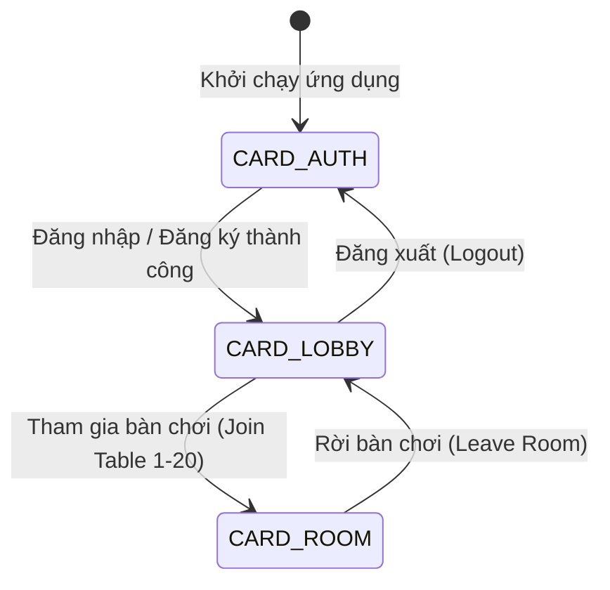

# Đặc Tả Giao Diện & Ánh Xạ Dữ Liệu (UI & Data Mapping)

Tài liệu này đặc tả chi tiết kiến trúc giao diện đồ họa **Java Swing thuần**, cấu trúc chuyển đổi màn hình (CardLayout), các hộp thoại tương tác, và ánh xạ luồng dữ liệu gói tin **Packet v2** giữa Client/Admin với Máy chủ **Ba Cây Online**.

---

## 1. Tổng Quan Kiến Trúc Giao Diện

Hệ thống giao diện tuân thủ các nguyên tắc thiết kế hiện đại:
- **Ngăn xếp đồ họa:** Java Swing thuần kết hợp Java 2D Rendering Pipeline, khử răng cưa chữ và hình ảnh chất lượng cao (`bicubic` resampling), bảng màu chủ đạo Casino Royal Navy (`#0A192F`, `#172A45`) và Gold Accent (`#D4AF37`, `#F5D77F`).
- **Mô hình luồng Swing EDT Confinement:** Mọi thao tác cập nhật trạng thái UI bắt buộc được đẩy vào Event Dispatch Thread thông qua `SwingUtilities.invokeLater()`. Tuyệt đối không thực thi socket I/O trên luồng giao diện.
- **Tách biệt nhị phân:**
  - Ứng dụng người chơi (`client.jar`): Chạy qua `MainFrame` duy nhất với kiến trúc chuyển đổi `CardLayout`.
  - Ứng dụng quản trị (`admin.jar`): Chạy qua `AdminMainFrame` độc lập, cách ly hoàn toàn khỏi gói client.
- **Âm thanh phi phong tỏa (Asynchronous Sound):** Phát âm thanh chia bài, lật bài, đặt cược, rung chip và thắng cuộc trên các daemon thread riêng biệt thông qua `Sound.java`.

---

## 2. Ứng Dụng Người Chơi (Client GUI)

### 2.1. Cấu Trúc Khung Cửa Sổ Chính (`MainFrame`)

Ứng dụng người chơi sử dụng một cửa sổ `MainFrame` (kích thước chuẩn $1200 \times 800$, tối thiểu $1024 \times 700$), điều hướng các phân cảnh thông qua `CardLayout`:



| Tên Thẻ (Card) | Lớp Giao Diện | Vai Trò |
|---|---|---|
| `CARD_AUTH` | `AuthPanel.java` | Màn hình đăng nhập, đăng ký và thiết lập IP máy chủ |
| `CARD_LOBBY` | `LobbyPanel.java` | Sảnh hiển thị danh sách 20 bàn chơi, thanh công cụ hồ sơ & BXH |
| `CARD_ROOM` | `RoomPanel.java` | Khung bàn chơi chính tích hợp bàn nỉ xanh, cụm điều khiển cược và khung chat |

---

### 2.2. Màn Hình Xác Thực (`AuthPanel`)

Giao diện thẻ chuyển đổi giữa 2 tab **Đăng nhập** và **Đăng ký**, kèm nút mở hộp thoại cấu hình địa chỉ IP máy chủ kết nối.

```
+-------------------------------------------------------------+
|                     ♠ BA CÂY ONLINE ♠                       |
|           [ Đăng nhập ]            [ Đăng ký ]              |
|                                                             |
|   Tên đăng nhập: [________________________________]         |
|   Mật khẩu:      [********************************]         |
|                                                             |
|   [        ĐĂNG NHẬP NGAY        ]                          |
|                                                             |
|   [⚙ Cấu hình Máy chủ]              Trạng thái kết nối: OK  |
+-------------------------------------------------------------+
```

#### Dữ liệu gửi lên server (Client $\rightarrow$ Server):
- Đăng nhập: `LOGIN_REQ (0x01)` $\rightarrow$ `AuthRequest { username, password }`
- Đăng ký: `REGISTER_REQ (0x02)` $\rightarrow$ `RegisterRequest { username, password, displayName, email }`

#### Dữ liệu nhận từ server (Server $\rightarrow$ Client):
- Thành công: `AUTH_RESP (0x15)` $\rightarrow$ `AuthResult { success=true, userId, username, displayName, balance, role }`
  - Client lưu thông tin phiên hiện tại, tự động chuyển thẻ sang `CARD_LOBBY`.
  - Khởi tạo luồng gửi `HEARTBEAT_PING (0x2A)` định kỳ mỗi 15 giây.
- Thất bại: `ERROR_RESP (0x28)` $\rightarrow$ `ErrorCode` (ví dụ: `INVALID_CREDENTIALS`, `USERNAME_ALREADY_EXISTS`, `USER_NOT_FOUND`).
  - Hiển thị thông báo lỗi trực quan trên nhãn cảnh báo đỏ và reset trường nhập mật khẩu.

---

### 2.3. Sảnh Bàn Chơi (`LobbyPanel`)

Hiển thị thông tin người chơi hiện tại và lưới trực quan gồm **20 bàn chơi cố định**:

```
+-----------------------------------------------------------------------------------+
| ♠ BA CÂY | Người chơi: Tuấn Kiệt | Điểm: 1,500.00 💰 | [Hồ sơ] [Lịch sử] [BXH] [Thoát] |
+-----------------------------------------------------------------------------------+
| SẢNH BÀN CHƠI (Tự động cập nhật thời gian thực)                                   |
| +-----------------+  +-----------------+  +-----------------+  +----------------+ |
| | BÀN SỐ 1        |  | BÀN SỐ 2        |  | BÀN SỐ 3        |  | BÀN SỐ 4       | |
| | Cược sàn: 10.00 |  | Cược sàn: 50.00 |  | Cược sàn: 20.00 |  | Cược sàn: 10.0 | |
| | Người chơi: 4/8 |  | Người chơi: 8/8 |  | Người chơi: 1/8 |  | Người chơi: 0/8| |
| | Trạng thái: CHƠI|  | Trạng thái: ĐẦY |  | Trạng thái: CHỜ |  | Trạng thái: TRỐNG|
| |   [ VÀO BÀN ]   |  |   [ ĐẦY CHỖ ]   |  |   [ VÀO BÀN ]   |  |   [ VÀO BÀN ]  | |
| +-----------------+  +-----------------+  +-----------------+  +----------------+ |
| ... (Hiển thị đầy đủ 20 bàn)                                                      |
+-----------------------------------------------------------------------------------+
```

#### Tương tác & Luồng dữ liệu:
- Khi vào sảnh hoặc nhấn nút Làm mới: Nhận gói `ROOM_SNAPSHOT (0x16)` chứa danh sách 20 bàn chơi (`List<RoomSnapshot>`).
- Click `[VÀO BÀN]`: Gửi `JOIN_ROOM_REQ (0x03)` $\rightarrow$ `JoinRoomRequest { roomId }`.
  - Server kiểm tra điều kiện (số dư $\ge$ Ante, bàn chưa đầy, trạng thái bàn).
  - Nếu hợp lệ: Server gửi `ROOM_SNAPSHOT` của bàn đó $\rightarrow$ Client chuyển sang `CARD_ROOM`.
  - Nếu lỗi: Server gửi `ERROR_RESP` (ví dụ `NOT_ENOUGH_BALANCE`, `ROOM_FULL`).

---

### 2.4. Khung Bàn Chơi (`RoomPanel`)

Bao gồm 3 phân khu giao diện chính:
1. **Thanh tiêu đề bàn:** Tên bàn, số hiệu phòng, mức cược Ante, nút Bắt đầu (cho Chủ bàn), nút Sẵn sàng và nút Rời bàn.
2. **Khu vực trung tâm (`GameTablePanel`):** Bàn nỉ xanh oval mô phỏng sòng bài chuyên nghiệp:
   - 8 vị trí ghế ngồi (Avatar, Tên hiển thị, Số dư, Thẻ bài úp/mở, Nhãn vai trò Chủ bàn / Sẵn sàng).
   - Thanh đếm ngược thời gian lượt (Turn Timer bar - 30 giây).
   - Khay Pot trung tâm hiển thị Pot chính và các Pot phụ (Main Pot & Side Pots).
   - Cơ chế rê chuột xem bài (Card Squeeze / Peek Effect).
3. **Bảng điều khiển cược (`GamePanel`):** Nằm sát cạnh dưới bàn chơi:
   - Các nút hành động: **Kiểm tra (Check)**, **Theo (Call)**, **Tố đến (Raise to)** kèm thanh kéo / ô nhập số điểm, **Tất tay (All-in)**, **Úp bài (Fold)**, và nút **Ẩn/Hiện bài**.
4. **Cột chat bên phải:** Khung chat trực tuyến trong bàn:
   - Chỉ hiển thị tin nhắn trò chuyện thuần túy giữa những người chơi trong bàn và thông báo hệ thống quan trọng.
   - Giới hạn tối đa 500 ký tự mỗi tin nhắn, tự động cuộn xuống dưới cùng khi có tin nhắn mới.

#### Ánh xạ gói tin chi tiết trong bàn chơi:

| Gói Tin | Chiều | Dữ Liệu Trao Đổi | Thao Tác Giao Diện Tương Ứng |
|---|---|---|---|
| `READY_REQ` | C $\rightarrow$ S | `null` | Người chơi nhấn nút **Sẵn sàng** / **Hủy sẵn sàng** |
| `START_GAME_REQ` | C $\rightarrow$ S | `null` | Chủ bàn nhấn nút **Bắt đầu ván bài** |
| `UPDATE_ANTE_REQ` | C $\rightarrow$ S | `BigDecimal` | Chủ bàn điều chỉnh mức cược cơ bản của bàn |
| `LEAVE_ROOM_REQ` | C $\rightarrow$ S | `null` | Người chơi rời bàn chơi, chuyển về `CARD_LOBBY` |
| `GAME_ACTION_REQ` | C $\rightarrow$ S | `GameActionRequest` | Gửi hành động cược (`action`, `raiseAmount`) |
| `ROOM_CHAT_REQ` | C $\rightarrow$ S | `String` | Gửi nội dung tin nhắn chat trong phòng |
| `ROOM_SNAPSHOT` | S $\rightarrow$ C | `RoomSnapshot` | Cập nhật vị trí ghế, trạng thái sẵn sàng, chủ bàn |
| `PLAYER_STATE_SNAPSHOT` | S $\rightarrow$ C | `PlayerStateSnapshot` | Cập nhật 3 lá bài riêng của người chơi, số dư |
| `GAME_STATE_SNAPSHOT` | S $\rightarrow$ C | `GameStateSnapshot` | Đổi lượt người chơi, kích hoạt bộ đếm 30s |
| `BET_STATE_SNAPSHOT` | S $\rightarrow$ C | `BetStateSnapshot` | Cập nhật số điểm trong Pot chính, Pot phụ |
| `ROOM_CHAT_EVENT` | S $\rightarrow$ C | `RoomChatEvent` | Thêm dòng tin nhắn vào khung chat bên phải |
| `ROUND_RESULT` | S $\rightarrow$ C | `RoundResult` | Lật bài tất cả người chơi, phát âm thanh thắng/thua, hiển thị hộp thoại kết quả ván |
| `PLAY_AGAIN_PROMPT` | S $\rightarrow$ C | `PlayAgainPrompt` | Hiển thị bảng hỏi chơi tiếp với đồng hồ đếm ngược 6s |
| `PLAY_AGAIN_REQ` | C $\rightarrow$ S | `Boolean` | Gửi xác nhận có tiếp tục chơi ván mới hay không |

---

### 2.5. Các Hộp Thoại Chức Năng (Dialogs)

- **`ProfileDialog` (Hồ sơ cá nhân & Đổi mật khẩu):**
  - Hiển thị thống kê tài khoản: Số ván chơi, số ván thắng, số ván thua, tỷ lệ thắng.
  - Form cập nhật tên hiển thị và email $\rightarrow$ gửi `UPDATE_PROFILE_REQ (0x0B)`.
  - Form đổi mật khẩu (yêu cầu mật khẩu cũ và xác nhận mật khẩu mới) $\rightarrow$ gửi `CHANGE_PASSWORD_REQ (0x0C)`.
- **`DataDialog` (Lịch sử ván bài & Bảng xếp hạng):**
  - Sử dụng giao diện tab tích hợp và phân trang chuyên dụng (Trang trước, Trang sau, Số trang hiện tại).
  - Tab 1: **Lịch sử ván bài** $\rightarrow$ gửi `GAME_HISTORY_REQ (0x0E)` $\rightarrow$ nhận `PAGE_RESULT<GameHistoryItem>`.
    - Các cột: Mã ván, Bàn chơi, Kết quả (Thắng/Thua/Úp), Biến động điểm (+/-), Loại bài, Thời gian.
  - Tab 2: **Bảng xếp hạng** $\rightarrow$ gửi `LEADERBOARD_REQ (0x0F)` $\rightarrow$ nhận `PAGE_RESULT<LeaderboardItem>`.
    - Các cột: Thứ hạng, Tên người chơi, Tổng điểm số, Số ván thắng, Tỷ lệ thắng. Dòng của chính người dùng được highlight màu vàng kim.

---

## 3. Ứng Dụng Quản Trị Viên (Admin GUI)

Ứng dụng quản trị độc lập (`AdminMainFrame`) cung cấp bảng điều khiển toàn diện cho người vận hành hệ thống:

```
+-----------------------------------------------------------------------------------+
| ♠ BA CÂY ADMIN CONSOLE | Quản trị viên: admin | [Đăng xuất]                       |
+-----------------------------------------------------------------------------------+
| [📊 TỔNG QUAN]  [👥 NGƯỜI CHƠI]  [🎲 GIÁM SÁT BÀN]  [📜 SỔ CÁI]  [📢 THÔNG BÁO]   |
+-----------------------------------------------------------------------------------+
| (Nội dung hiển thị theo tab chức năng được chọn)                                  |
+-----------------------------------------------------------------------------------+
```

### 3.1. Các Phân Hệ Quản Trị

#### 1. Tổng quan hệ thống (`DashboardPanel`):
- **5 thẻ KPI thời gian thực:** Tổng số tài khoản, Người chơi trực tuyến, Số bàn đang hoạt động, Tổng số dư lưu hành, Số ván đấu trong ngày.
- **Tự động làm mới:** Luồng `ScheduledExecutorService` định kỳ mỗi 5 giây tự động gửi `ADMIN_STATS_REQ (0x2D)` và cập nhật `ADMIN_STATS_RESP (0x2E)` trên luồng EDT.
- **Phát thông báo toàn hệ thống (Broadcast):** Nhập nội dung thông báo khẩn $\rightarrow$ gửi `ADMIN_BROADCAST_REQ (0x36)` $\rightarrow$ Máy chủ phát thanh đến tất cả người chơi trong các bàn qua `ROOM_CHAT_EVENT`.

#### 2. Quản lý người chơi (`UsersPanel`):
- Bảng danh sách tài khoản hỗ trợ phân trang (20 bản ghi/trang).
- Tìm kiếm theo Username hoặc Tên hiển thị; Lọc theo vai trò (`USER`, `ADMIN`) và trạng thái (`ACTIVE`, `BLOCKED`).
- **Khóa / Mở khóa tài khoản:** Gửi `ADMIN_LOCK_USER_REQ (0x31)` $\rightarrow$ Lập tức ngắt phiên làm việc nếu tài khoản bị khóa.
- **Điều chỉnh số dư có kiểm toán:** Hộp thoại cộng/trừ điểm với trường bắt buộc nhập **Lý do can thiệp** $\rightarrow$ gửi `ADMIN_ADJUST_BALANCE_REQ (0x32)` $\rightarrow$ Tự động ghi vào bảng `admin_adjustments`.

#### 3. Giám sát 20 bàn chơi (`RoomsPanel` & `LiveRoomInspectorDialog`):
- Theo dõi trạng thái từng bàn: Số lượng người ngồi, mức cược Ante, tổng điểm trong Pot hiện tại, giai đoạn ván bài.
- **Buộc đặt lại bàn (Force Reset Room):** Gửi `ADMIN_FORCE_RESET_ROOM (0x35)` để giải phóng bàn chơi nếu xảy ra tình huống treo mạng hoặc lỗi logic.

#### 4. Sổ cái tài chính (`LedgerPanel`):
- Tra cứu lịch sử biến động số dư toàn hệ thống có phân trang: gửi `ADMIN_LEDGER_PAGE_REQ (0x37)` $\rightarrow$ nhận `ADMIN_LEDGER_PAGE_RESP (0x38)`.
- Hiển thị chi tiết từng biến động: Mã ván đấu / Mã kiểm toán, Người chơi, Số dư trước, Biến động (+/-), Số dư sau, Lý do ghi nhận.

---

## 4. Quản Lý Phiên Bản & Tính Nhất Quán Dữ Liệu

1. **Phòng tránh cập nhật cũ đè mới (`stateVersion`):**
   - Mỗi gói `RoomSnapshot` và `GameStateSnapshot` đều đính kèm trường số nguyên `stateVersion` tự tăng tại máy chủ.
   - Client duy trì `lastObservedVersion`. Nếu nhận được gói tin có `stateVersion <= lastObservedVersion`, client lập tức bỏ qua để tránh hiện tượng tráo đổi thứ tự gói tin trên đường truyền.
2. **Đồng bộ hóa trạng thái nút điều khiển:**
   - Các nút Tố, Theo, Kiểm tra, Tất tay được kích hoạt hoặc vô hiệu hóa theo thời gian thực dựa trên `currentTurnUserId`, `currentHighBet`, và số dư khả dụng của người chơi.
3. **Độ an toàn khi mất kết nối mạng:**
   - Khi socket bị ngắt đột ngột, `ConnectionController` hiển thị thông báo mất kết nối, chuyển giao diện về trạng thái an toàn và kích hoạt cơ chế thử kết nối lại tự động.
