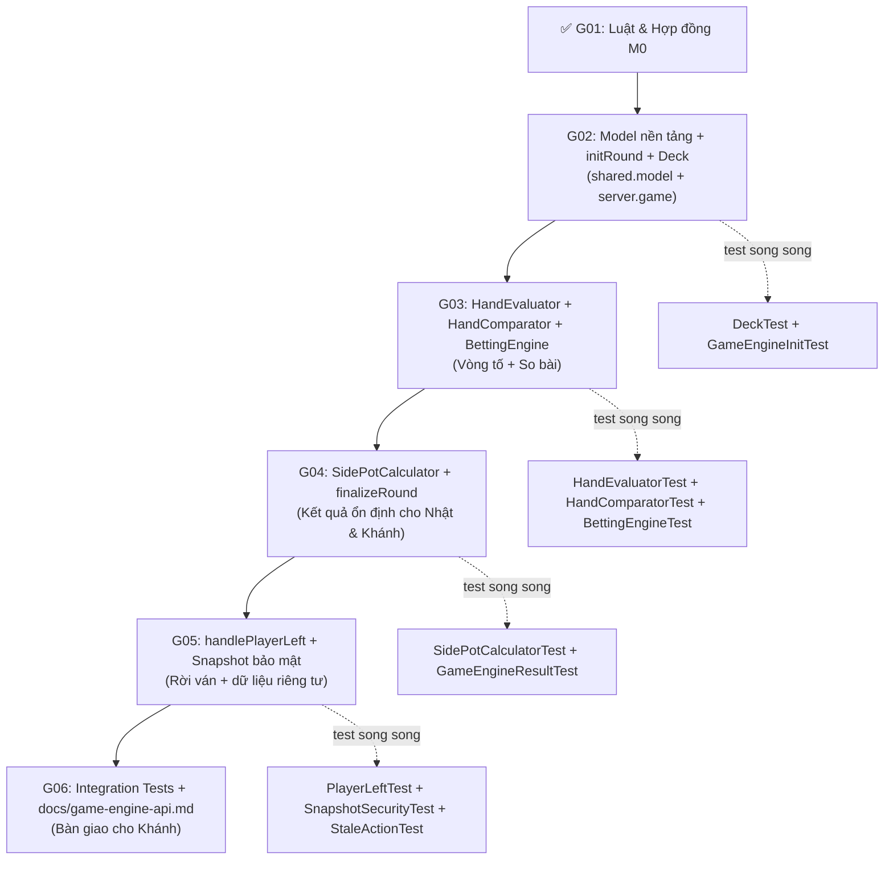

# 🎮 Kế Hoạch Triển Khai Game Engine — Trọng (G01–G06)

> **Branch:** `tronghm`  
> **Package Engine:** `com.game3cay.server.game`  
> **Package Model Mạng / Snapshot:** `com.game3cay.shared.model`  
> **Nguyên tắc vàng:** Game Engine **KHÔNG** mở socket, **KHÔNG** tạo Swing, **KHÔNG** truy cập CSDL.

---

## 📊 Tổng Quan Trạng Thái

| Task | Tên | Mốc bắt buộc | Trạng thái | Ưu tiên | File kế hoạch chi tiết |
|:---:|-----|:---:|:---:|:---:|---|
| **G01** | Luật & Hợp Đồng Ghép | M0 | ✅ **HOÀN THÀNH** | — | [g01_engine_contract.md](file:///d:/Project/bacay-online/g01_engine_contract.md) |
| **G02** | Khởi Tạo & Dữ Liệu Ván | M4.1 | ✅ **HOÀN THÀNH** | **P1** | [plan_g02.md](file:///d:/Project/bacay-online/plan_g02.md) |
| **G03** | Xử Lý Hành Động (BettingEngine) | M4.1 | ✅ **HOÀN THÀNH** | **P1** | [plan_g03.md](file:///d:/Project/bacay-online/plan_g03.md) |
| **G04** | Kết Quả & Vòng Đời (SidePot) | M4.1, M5.1 | ✅ **HOÀN THÀNH** | **P1** | [plan_g04.md](file:///d:/Project/bacay-online/plan_g04.md) |
| **G05** | Rời Ván & Snapshot | M4.2 | ❌ Chưa bắt đầu | **P2** | [plan_g05.md](file:///d:/Project/bacay-online/plan_g05.md) |
| **G06** | Test Toàn Diện & API Cho Khánh | M4.1→M6 | ❌ Chưa bắt đầu | **Xuyên suốt** | [plan_g06.md](file:///d:/Project/bacay-online/plan_g06.md) |

> 📖 **Đọc plan chi tiết từng task trước khi bắt tay code.**

---

## 🏛️ Kiến Trúc Module — Quy Tắc Quan Trọng Nhất

> [!IMPORTANT]
> **Tại sao phải chia ra `shared` và `server`?**
>
> - `client` của Thành **chỉ phụ thuộc `shared`**, không biết đến `server`.
> - [PacketIO.java](file:///d:/Project/bacay-online/shared/src/main/java/com/game3cay/shared/network/PacketIO.java) có `ObjectInputFilter` chỉ cho phép deserialize `com.game3cay.shared.model.*`.
> - → Mọi DTO truyền qua mạng (Card, Hand, Snapshot, RoundResult...) **phải nằm trong `shared.model`**.
> - → Thuật toán, engine logic, trạng thái RAM nội bộ nằm trong `server.game`.

### Sơ đồ phân bổ file

```
shared/src/main/java/com/game3cay/shared/model/
│   [G02] Rank, Suit, Card, HandType, Hand
│   [G02] BetAction, GamePhase, RoundStatus
│   [G03] BetRecord, PlayerBetInfo
│   [G03] GameStateSnapshot, BetStateSnapshot, PlayerStateSnapshot
│   [G04] SidePot, PlayerResult, RoundResult
│
server/src/main/java/com/game3cay/server/game/
│   RoundContext.java              ← [ĐÃ CÓ SẴN] Không sửa
│   GameEngine.java                ← Interface cho Khánh gọi
│   GameEngineImpl.java            ← Triển khai tất cả G02-G05
│
├── exception/
│   └── GameException.java         ← [G02] Bọc ErrorCode
│
├── model/
│   ├── PlayerState.java           ← [G02] RAM nội bộ 1 người
│   └── GameState.java             ← [G02] RAM nội bộ 1 ván
│
└── engine/
    ├── Deck.java                   ← [G02] Bộ bài 52 lá
    ├── HandEvaluator.java          ← [G03] Phân loại bài
    ├── HandComparator.java         ← [G03] So sánh bài
    ├── BettingEngine.java          ← [G03] Vòng tố
    └── SidePotCalculator.java      ← [G04] Chia pot phụ

server/src/test/java/com/game3cay/server/game/
    DeckTest.java                   ← [G02]
    GameEngineInitTest.java         ← [G02]
    HandEvaluatorTest.java          ← [G03]
    HandComparatorTest.java         ← [G03]
    BettingEngineTest.java          ← [G03]
    SidePotCalculatorTest.java      ← [G04]
    GameEngineResultTest.java       ← [G04]
    PlayerLeftTest.java             ← [G05]
    SnapshotSecurityTest.java       ← [G05]
    StaleActionTest.java            ← [G05]
    GameEngineIntegrationTest.java  ← [G06]
    GameEngineCancelTest.java       ← [G06]
    GameEngineEdgeCaseTest.java     ← [G06]
    GameEngineContractTest.java     ← [G06]
```

---

## 🔑 10 Quyết Định Kỹ Thuật Đã Chốt (G01)

Xem chi tiết tại [g01_engine_contract.md](file:///d:/Project/bacay-online/g01_engine_contract.md).

| # | Hạng mục | Quyết định | Khớp base code |
|---|----------|-----------|----------------|
| 1 | `userId` / `playerId` type | **`long`** | `users.id BIGINT`, `UserDTO.userId`, `RoundContext.playerIds` |
| 2 | `roomId` type | **`long`** | `rooms.id BIGINT`, `RoundContext.roomId` |
| 3 | Tiền tệ | **`BigDecimal`** | `DECIMAL(15,2)`, `RoundContext.betAmount`, `PacketIO` |
| 4 | `roundId` format | **`String` UUID** | Khánh sinh, lưu `games.round_id VARCHAR(36)` |
| 5 | `hand_type` values | `SAP`, `LIENG`, `BO_DOI`, `DIEM` | `game_players.hand_type` |
| 6 | `result` values | `WIN`, `LOSE`, `DRAW`, `FOLD`, `CANCELLED` | `game_players.result` |
| 7 | `roundStatus` values | `WAITING`, `PLAYING`, `FINISHED`, `CANCELLED` | `games.status` |
| 8 | Dữ liệu khởi tạo | Dùng `RoundContext` có sẵn | `server/game/RoundContext.java` |
| 9 | Ante | Engine trực tiếp trừ `betAmount` | — |
| 10 | Dealer & lượt đi | Khánh truyền `dealerIndex`, Engine tính `(dealerIndex+1) % size` | — |

---

## 🚀 Thứ Tự Triển Khai



---

## ⚠️ Nguyên Tắc Không Được Vi Phạm

> [!WARNING]
> Engine **KHÔNG TỰ TẠO LUỒNG**. Toàn bộ concurrent safety do Khánh đảm bảo qua tuần tự hóa bên ngoài.

> [!CAUTION]
> `PlayerStateSnapshot` chỉ được gửi riêng cho đúng userId đó. **Tuyệt đối không broadcast**.

> [!NOTE]
> Khi `GameException` ném ra, **trạng thái ván không được thay đổi**. Mọi validation phải xảy ra trước khi apply bất kỳ thay đổi nào vào `GameState`.
